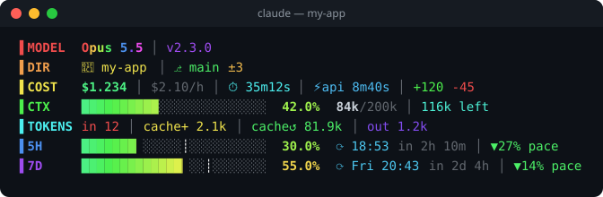
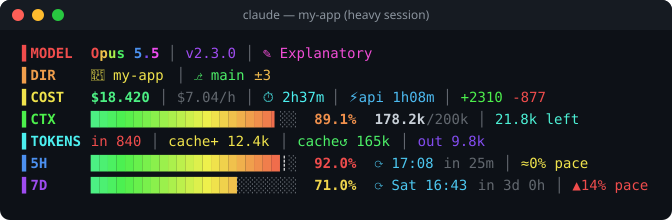

<div align="center">

# 🌈 prismline

**A rainbow, information-dense status line for [Claude Code](https://claude.com/claude-code).**

See your model, git state, cost, context window, tokens and plan limits at a glance, with pace tracking that tells you if you're burning through your quota too fast.

[](LICENSE)




</div>

---

## ✨ Why prismline?

The default status line tells you almost nothing. prismline packs everything you care about during a long coding session into one glanceable block:

- 🎨 **Rainbow truecolor**: every row has its own colour, and bars fade from green to red as they fill
- 🧠 **Context window**: how full it is, exactly how many tokens are left, and the cache breakdown
- 💸 **Cost tracking**: session cost, $/hour burn rate, wall time vs API time
- ⏳ **Plan limits with pace**: your 5-hour and 7-day usage with a `┊` marker showing where you *should* be at an even pace
- 🌿 **Git aware**: current branch, plus the number of changed files (or ✓ when clean)
- 🪶 **Zero dependencies**: one Node.js file, fast enough to run on every refresh

### When things get heavy

<div align="center">

</div>

Numbers shift from green → yellow → orange → red at 25 / 50 / 75 / 90 %, so you know when to `/compact` or slow down before you hit a wall.

## 📊 What each row means

| Row | Shows |
|-----|-------|
| `MODEL` | Model name · Claude Code version · output style (if not default) |
| `DIR` | Folder · `⎇ branch` · `±N` changed files or `✓` |
| `COST` | `$` session cost · `$/h` burn rate · `⏱` wall time · `⚡api` API time · `+added -removed` lines |
| `CTX` | Context bar · % used · `used/total` tokens · tokens left |
| `TOKENS` | `in` input · `cache+` cache write · `cache↺` cache read · `out` output |
| `5H` / `7D` | Plan usage bar · `⟳` reset time and countdown · pace indicator |

**Reading the pace indicator:**

| Symbol | Meaning |
|--------|---------|
| `▲ 14% pace` | You're 14 % **ahead** of an even pace. Slow down or you'll hit the limit early |
| `≈ 0% pace` | Right on track |
| `▼ 27% pace` | You're 27 % **under** pace. Plenty of room left |

The `┊` inside the bar marks the even-pace position, so you can see it at a glance too.

## 🚀 Install

> Requires **Node.js 18+** and a truecolor terminal (Windows Terminal, iTerm2, WezTerm, Kitty, GNOME Terminal, VS Code…).

### One-liner

```bash
npx github:satetapongsa/skill-status-l
```

Then restart Claude Code. That's it.

### As a Claude Code plugin

```
/plugin marketplace add satetapongsa/skill-status-l
/plugin install prismline@prismline
```

Then just ask Claude: *"install prismline"*. The bundled skill handles setup, and you can also ask it to tweak or remove the status line later.

### Manual

```bash
git clone https://github.com/satetapongsa/skill-status-l.git
node prismline/skills/prismline/scripts/install.js
```

<details>
<summary><b>What does the installer change?</b></summary>

1. Copies `statusline.js` to `~/.claude/statusline.js` (an existing one is backed up to `statusline.backup.js`)
2. Saves your current `statusLine` setting to `~/.claude/prismline.settings-backup.json`
3. Sets this in `~/.claude/settings.json`:

```json
"statusLine": {
  "type": "command",
  "command": "node \"~/.claude/statusline.js\"",
  "padding": 0
}
```

Nothing else in your settings is touched.
</details>

## 🗑️ Uninstall

```bash
npx github:satetapongsa/skill-status-l --uninstall
```

Your previous status line setting is restored exactly as it was.

## 🎛️ Customize

Edit `~/.claude/statusline.js`. Changes show up on the next refresh, so you don't need to restart.

| Want to… | Change |
|----------|--------|
| Make bars wider/narrower | `const W = 24;` |
| Change row colours | `ROW` array of hues (0–360) |
| Change warning thresholds | `level()` function |
| Hide a row | Delete its `lines.push(...)` block |
| Use a 16-colour terminal | Replace `hue()` with codes like `\x1b[32m` |

Preview without opening Claude Code:

```bash
echo '{"model":{"display_name":"Opus"},"context_window":{"used_percentage":42}}' | node ~/.claude/statusline.js
```

## 🛠️ Development

```bash
npm test        # smoke tests (node:test, no deps)
npm run demo    # regenerate assets/*.svg from real output
npm run preview # print a sample status line to your terminal
```

```
prismline/
├── .claude-plugin/          # plugin + marketplace manifests
├── skills/prismline/
│   ├── SKILL.md             # lets Claude install/customize it for you
│   └── scripts/
│       ├── statusline.js    # the status line itself
│       └── install.js       # installer / uninstaller
├── tools/render-demo.js     # ANSI → SVG screenshot generator
└── test/
```

Issues and PRs are welcome! If you make a cool theme, share it.

## 🇹🇭 ภาษาไทย

**prismline** คือ status line สีรุ้งสำหรับ Claude Code บอกทุกอย่างที่ต้องรู้ระหว่างเขียนโค้ดในจอเดียว:
โมเดล, git branch, ค่าใช้จ่าย, context window ที่เหลือ, จำนวน token และโควตา 5 ชั่วโมง / 7 วัน
พร้อมตัวบอก **pace**: `▲` แปลว่าใช้เร็วเกินไป, `▼` แปลว่ายังเหลือเยอะ

**ติดตั้ง:**

```bash
npx github:satetapongsa/skill-status-l
```

แล้วเปิด Claude Code ใหม่ หรือติดตั้งเป็น plugin:

```
/plugin marketplace add satetapongsa/skill-status-l
/plugin install prismline@prismline
```

**ถอนการติดตั้ง:** `npx github:satetapongsa/skill-status-l --uninstall` (คืนค่าเดิมให้อัตโนมัติ)

ต้องมี Node.js 18 ขึ้นไป และเทอร์มินัลที่รองรับ truecolor เช่น Windows Terminal

---

<div align="center">

If prismline makes your sessions nicer, a ⭐ helps other people find it.

MIT © [satetapongsa](https://github.com/satetapongsa)

</div>
